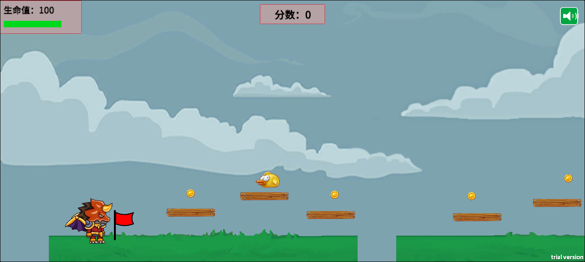

# 火龙探险

一个使用 **Unity 2D + C#** 制作的横版动作闯关 Demo。玩家控制火龙跨越平台、收集金币、发射火球击败敌人，并利用检查点继续挑战，最终到达绿色终点旗。

**[在线试玩](https://3273352747.github.io/fire-dragon-adventure/)** · **[开发与发布说明](docs/DEVELOPMENT.md)** · **[测试清单](docs/TESTING.md)** · **[另一个作品：2D跑酷](https://github.com/3273352747/2d-parkour)**

> 本仓库是可直接部署的 WebGL 发布仓库，不是 Unity 源码仓库。这里保存网页入口、构建产物和项目文档；文中 C# 模块名用于说明原工程设计，不代表这些源码已在本仓库公开。

## 项目概览

| 项目 | 说明 |
| --- | --- |
| 游戏类型 | 单机 2D 横版动作闯关 |
| 开发工具 | Unity 2022.3.62f3c1、C#、UGUI、Animator、Physics2D |
| 主要内容 | 移动与跳跃、火球攻击、金币、敌人、机关、检查点、通关 |
| 交互反馈 | 动画、奔跑拖尾、爆炸效果、血条、分数、音效 |
| 发布形式 | 当前仓库提供 WebGL 试玩；原工程也有 Windows 构建 |
| 开发定位 | 个人学习与作品展示，重点是可运行的玩法闭环和问题排查 |

## 游戏画面



## 玩法与操作

1. 从主菜单进入关卡，向右探索平台和道路。
2. 收集金币获得分数，利用跳跃避开障碍；遇到鸟敌人时，可以发射火球攻击。
3. 触碰检查点旗记录重生位置，抵达绿色终点旗完成关卡。
4. 注意血量：敌人接触默认扣 25 点，炸弹默认扣 50 点，生命上限为 100。血量耗尽后重生，掉入陷阱区域则直接重生。
5. 炸弹触发后播放爆炸并消失；移动球体在限定范围内往返，接触会造成伤害。

| 操作 | 输入 |
| --- | --- |
| 左右移动 | A / D 或左右方向键 |
| 跳跃 | 空格 |
| 发射火球 | J 或鼠标左键 |
| 暂停 / 继续 | Esc 或游戏内菜单 |
| 静音切换 | 右上角声音按钮 |

金币默认加 10 分，击败鸟敌人加 20 分。数值来自原工程默认配置，场景或预制体可单独覆盖。

推荐使用电脑端 Chrome 或 Edge，先点击游戏画面获得键盘焦点。网页首次加载需要下载资源；浏览器可能需要一次用户交互才允许播放声音。WebGL 中的退出操作不会像桌面程序一样自动关闭浏览器标签页。

## 实现亮点

### 1. 角色、战斗与关卡规则分工

角色控制器处理输入、位移、朝向和攻击请求，火球负责飞行与碰撞，敌人负责巡逻、受击和死亡，关卡管理器维护生命、分数、检查点与通关。伤害来源提交数值，UI读取统一状态，减少同一规则散落在多个脚本中。

### 2. 动画表现与物理状态衔接

通过脚底检测点和 LayerMask 获取接地状态，并同步速度、竖直速度、攻击与受击参数。初始化时检查 Animator 参数是否存在及类型是否匹配，降低控制脚本与动画控制器配置不一致带来的报错。

这里的“参数缓存”指缓存参数检查结果，不等同于已经完成所有 Animator 性能优化。

### 3. 火球攻击形成完整链路

攻击请求经过冷却后生成火球，火球根据朝向飞行，并设置存活时间；命中敌人后进入受击与死亡处理。敌人死亡状态用于拦截重复死亡结算，攻击动画、命中、加分和销毁形成连续反馈。

### 4. 分级伤害与统一重生

生命值扣减、血条刷新、死亡判断和重生入口集中管理。重生时锁定角色控制、回到出生点或检查点、清空速度并恢复生命；流程中使用重生状态避免重复进入。

### 5. 针对横版玩法的镜头与视觉反馈

摄像机只沿水平方向平滑跟随，保留稳定的纵向构图；奔跑拖尾、火球、爆炸与受击音效补充操作反馈。精灵渲染层、出生点偏移和特效缩放分别可调，便于定位“生成了但看不见”的问题。

### 6. 从编辑器验证走到网页交付

除了在 Unity 内调试，还处理了构建所需资源引用、中文显示、页面标题及浏览器加载问题。发布层独立维护构建配置，提供资源路径检查与本地预览工具，避免把修改网页标题与重新编译整个游戏混为一谈。

## 开发流程

| 阶段 | 主要工作 | 验证目标 |
| --- | --- | --- |
| 玩法原型 | 搭建地面、平台、角色、镜头和基础碰撞 | 能完成移动、跳跃与场景探索 |
| 动画整合 | 整理待机、跑步、跳跃、攻击的参数与过渡 | 动作有明确入口和出口 |
| 战斗与机关 | 接入火球、鸟敌人、炸弹、移动球体 | 命中、扣血、死亡与反馈相互对应 |
| 关卡闭环 | 金币、计分、检查点、掉落、重生、终点 | 从主菜单到通关可以连续体验 |
| UI与表现 | 中文按钮、血条、分数、音效和特效 | 状态变化能在画面上正确体现 |
| 发布验证 | Windows / WebGL 构建、浏览器试玩与标题检查 | 构建后资源可加载，核心流程可操作 |

具体模块关系、问题排查思路和更新步骤见 [开发与发布说明](docs/DEVELOPMENT.md)。

## 仓库结构

```text
.
|-- index.html                 # 网页入口，保持原试玩地址
|-- web/
|   |-- build-config.json      # Unity 构建路径和运行配置
|   `-- boot.js                # 加载、进度、失败提示和全屏逻辑
|-- Build/                     # Unity 生成的游戏数据、WASM和加载器
|-- TemplateData/              # 网页样式、图标与加载图片
|-- docs/
|   |-- DEVELOPMENT.md         # 原工程模块、开发过程与发布维护
|   |-- TESTING.md              # 浏览器和玩法回归清单
|   `-- images/                # 实际游戏截图
|-- licenses/
|   `-- FONT-LICENSE-NotoSansSC.txt
|-- tools/
|   |-- check-site.mjs         # 构建路径、网页资源、文档链接检查
|   |-- test-boot.mjs          # 启动成功与失败分支测试
|   `-- serve.mjs              # 仅本机监听的静态预览服务
|-- .gitignore
`-- .nojekyll                  # 保留静态文件发布方式
```

`Build/` 和 `TemplateData/` 保留 Unity 导出时的名称，避免无必要地修改资源路径。不要手工修改 `.wasm`、`.data` 或生成的 framework 文件。

## 本地预览

安装 Node.js 18 或更高版本后，在仓库根目录运行，无需 npm install：

```bash
node tools/check-site.mjs
node tools/test-boot.mjs
node tools/serve.mjs 8080
```

浏览器访问 **http://127.0.0.1:8080**，按 Ctrl+C 停止服务。若端口占用，改用 8081 等其他端口。不要直接双击 `index.html` 使用 `file://` 打开，游戏需要通过 HTTP 加载资源。

检查脚本通过只代表静态文件与引用完整，不代表已经完成整关通关测试。

## 当前边界与后续思路

以下是后续计划，不是已经完成的功能：

- **统一跳跃规则**：明确单次跳跃或连跳设计，让输入许可、接地检测和动画状态保持一致，再评估土狼时间与输入缓冲。
- **提高近距离命中可靠性**：将火球出生保护限定到发射者，补充高速移动路径扫描，覆盖贴身发射和低帧率情况。
- **细化流程管理**：为提示与重生分别保存协程句柄，避免广泛停止协程；补充单例重复实例保护。
- **减少频繁创建销毁**：为火球和短时特效增加容量受控的对象池，验证复用后的动画、碰撞与计时状态。
- **扩展关卡内容**：增加有区分度的敌人、机关组合与检查点节奏，而不是只延长地图。
- **改善触屏体验与可测试性**：增加完整触控输入、分辨率测试及生命、计分、重复命中的自动化用例。
- **补充实测数据**：固定机型和操作路径后记录帧时间、内存与首次可交互耗时，再决定优化顺序。

当前版本是单机 Demo，没有多人联机、服务器排行榜或商业运营系统。GitHub Pages 的访问速度取决于网络环境，链接长期保留与仓库及 Pages 配置有关，不承诺任何网络下都能即时加载。

## 资源与使用说明

游戏包含第三方美术、音频及字体资源，发布试玩不代表这些资源可以被任意提取或再分发。本仓库不默认授予所有内容 MIT 等统一开源许可。

Noto Sans SC 字体遵循 SIL Open Font License，许可文本见 [字体许可证](licenses/FONT-LICENSE-NotoSansSC.txt)。复用其他素材前，请核对各自原始授权。
