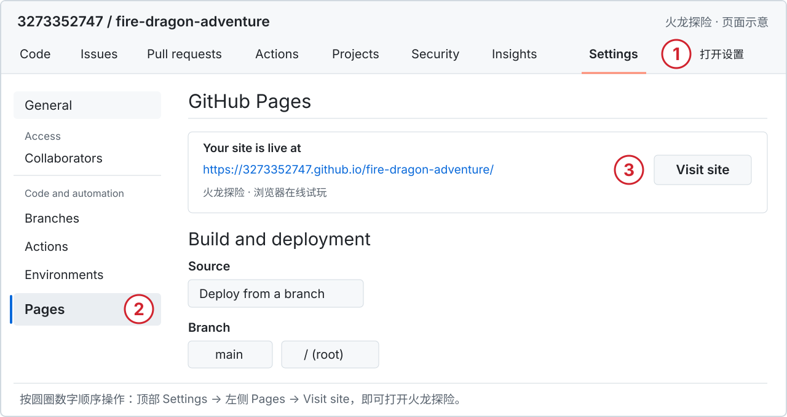

## 在线体验步骤

**直接进入：[火龙探险在线试玩](https://3273352747.github.io/fire-dragon-adventure/)**

拥有仓库设置权限时，也可以按图中的 **① Settings → ② Pages → ③ Visit site** 打开游戏。



# 火龙探险

使用 **Unity 2D + C#** 制作的横版动作闯关游戏。玩家控制火龙跨越平台、收集金币、发射火球击败敌人，沿途激活检查点，抵达绿色终点旗后过关。

**[在线试玩](https://3273352747.github.io/fire-dragon-adventure/)** · **[开发记录](docs/DEVELOPMENT.md)**

## 项目概览

| 项目 | 说明 |
| --- | --- |
| 游戏类型 | 单人 2D 横版动作闯关 |
| 开发工具 | Unity 2022.3.62f3c1、C#、UGUI、Animator、Physics2D |
| 主要玩法 | 移动、跳跃、火球攻击、金币收集、机关躲避、检查点与通关 |
| 画面与反馈 | 角色动画、奔跑拖尾、爆炸效果、血条、计分和音效 |
| 运行平台 | WebGL、Windows |

## 游戏画面


## 玩法与操作

1. 从主菜单进入关卡，向右探索平台和道路。
2. 跳过障碍、收集金币，遇到鸟敌人时可以发射火球攻击。
3. 触碰检查点旗记录重生位置，抵达绿色终点旗后过关。
4. 生命上限为100，敌人接触默认扣25点，炸弹默认扣50点。生命耗尽后重生，掉入陷阱区域则直接重生。
5. 炸弹触发后爆炸并消失；移动球体在限定范围内往返，接触会造成伤害。

| 操作 | 输入 |
| --- | --- |
| 左右移动 | A / D 或左右方向键 |
| 跳跃 | 空格 |
| 发射火球 | J 或鼠标左键 |
| 暂停 / 继续 | Esc 或游戏内菜单 |
| 静音切换 | 右上角声音按钮 |

金币默认加10分，击败鸟敌人加20分。

## 实现亮点

### 角色控制与关卡逻辑分开维护

我把输入、移动和攻击放在角色控制器里，火球和敌人各自处理飞行、碰撞与死亡，生命、分数和重生位置由关卡管理器维护。增加一种伤害来源时，只需要传入伤害值，扣血、刷新血条和死亡判断可以沿用现有逻辑。

### 用角色状态驱动动画

脚底检测点配合LayerMask判断接地，移动速度、竖直速度和接地状态用于更新Animator。初始化时按名称和类型检查动画参数，并缓存检查结果，方便发现控制脚本与动画控制器之间的配置问题。攻击和受伤通过独立触发参数控制。

### 火球攻击与击杀反馈

火球从发射点生成，随角色朝向调整位置和飞行方向。角色控制攻击冷却，火球负责速度、存活时间和命中处理。鸟敌人收到命中后先设置死亡标记，再关闭碰撞、切换死亡表现并加分，防止延迟销毁期间再次结算。

### 检查点与重生共用一套流程

检查点记录返回位置，血量归零和掉落都进入统一的重生流程。重生期间锁定角色控制，传送后清空刚体速度、恢复生命，再恢复操作。通过重生标记拦截重复请求，处理多个伤害回调同时到来的情况。

### 镜头与特效围绕横版操作调整

摄像机在LateUpdate中平滑跟随角色的水平位置，纵向保持稳定，便于观察平台和落点。奔跑拖尾、火球和爆炸分别设置出生位置、缩放与渲染层；角色转向时同步调整发射点，让动作和特效方向一致。

## 开发流程

| 阶段 | 主要工作 |
| --- | --- |
| 基础原型 | 搭建地面和平台，实现角色移动、跳跃、碰撞与镜头跟随 |
| 动画调试 | 配置待机、跑步、跳跃、攻击和受伤，逐条检查过渡条件 |
| 战斗与机关 | 加入火球、鸟敌人、炸弹和移动球体，接通伤害与击杀计分 |
| 关卡流程 | 实现金币、检查点、掉落检测、重生和终点判定 |
| 界面与反馈 | 完善中文按钮、血条、分数、暂停菜单、音效和特效 |
| 打包验证 | 导出Windows和WebGL版本，检查字体、资源引用和实际操作 |

模块关系和调试过程见 [开发记录](docs/DEVELOPMENT.md)。

## 仓库结构

```text
.
|-- index.html                 # 网页入口
|-- web/
|   |-- build-config.json      # 构建文件路径和运行配置
|   `-- boot.js                # 加载进度与错误提示
|-- Build/                     # Unity WebGL构建文件
|-- TemplateData/              # 网页样式与图片
|-- docs/
|   |-- DEVELOPMENT.md         # 开发记录
|   `-- images/                # 游戏截图
|-- licenses/                  # 字体许可证
|-- .gitignore
`-- .nojekyll
```

## 后续开发思路

接下来想先打磨跳跃和攻击手感，再围绕现有玩法扩展关卡内容。

### 可新增的功能

- **多关卡与进度保存**：增加关卡选择和通关解锁，保存已解锁关卡、最佳分数与收集进度，方便分次游玩。
- **不同攻击方式的敌人与Boss**：在现有巡逻敌人的基础上加入远程攻击、追击和阶段性Boss，通过攻击前摇提示玩家躲避或反击。
- **道具与角色强化**：加入回血、临时护盾和火球强化，让玩家在收集金币之外，也需要判断何时拾取和使用道具。
- **关卡挑战目标**：增加限时通关、无伤通关和金币全收集，根据完成情况展示评价，提高重复游玩的目标感。

### 现有功能优化

- **跳跃与动画衔接**：明确起跳和连跳条件，补充离开平台后短暂的起跳宽限、落地前输入缓冲，改善平台边缘和连续操作的手感。
- **火球命中判定**：将出生保护限定为忽略发射者，并增加沿飞行路径的碰撞检测，减少贴身攻击和低帧率下的漏命中。
- **关卡节奏与难度**：重新安排平台、敌人、机关和检查点的位置，让前段熟悉操作、中段组合挑战、后段提高难度。
- **运行性能与重生流程**：使用对象池复用火球和短时特效；分别管理提示与重生协程，减少频繁创建销毁和流程互相打断的问题。
- **网页和触屏操作**：加入虚拟方向键与攻击按钮，优化不同屏幕比例下的UI；处理进入游戏后的焦点、首次交互后的声音恢复，并将网页版退出调整为返回主菜单。
